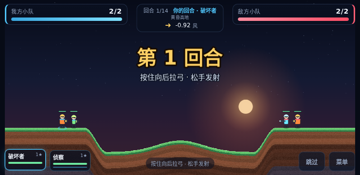
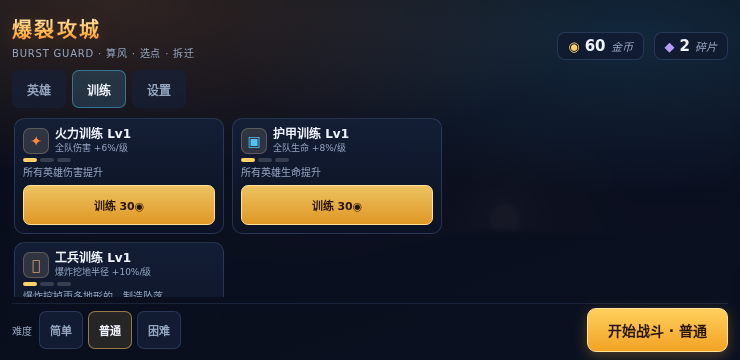

# 爆裂攻城 · BURST GUARD

> 手机横屏的回合制弹射对战游戏：**算风、反向拉弓，把对面小队一个个从可破坏地形上抹掉**。
> Phaser 3 + TypeScript + Vite；引擎与表现层解耦，全部美术/音效程序化生成，零外部素材文件。

## 玩法

- 横屏单指**反向拉弓**：按住战场向**反方向**拖（向左下拖 → 炮弹向右上飞，手指不遮落点），拖拽距离 = 力度，松手发射；点底部英雄头像可切换本回合出手英雄；开战自动请求浏览器全屏。
- **4 张地图**（黄昏高地/碎骨裂谷/双峰隘口/赤岩台地）按场次轮换；每边 2–4 名英雄，**团灭对方小队即胜**。
- 炮弹命中后先炸地形（像素级圆坑），再结算单位伤害；回合末一次性处理悬空/滑落/坠底与胜负。
- 14 回合打满进入**猝死**：第 15 回合起每回合全体掉血并逐回合加重，保证有限终局。
- 局外：结算金币/碎片 → 英雄升星、队伍训练三条线、解锁新英雄与更多上场名额 → 更强的对手。

7 名英雄各绑定 1 把武器：破坏者（重炮）、侦察（15 枚集束）、枪手（直线穿甲）、乌鸦（延迟二爆）、医疗（边打边奶）、迫击（超远高抛）、工兵（挖地 1.7 倍制造坠落）。

## 特性

- **可破坏地形**：1280×640 `Uint32Array` 像素掩码为唯一真相，`support` 派生索引；圆坑按行求区间，只重绘脏矩形。
- **纯击杀胜负**：城堡/核心/城墙/炮塔已从 v3 删除，胜负只看小队存活；火力全部集中在「怎么把人打掉」。
- **养成三条线**：英雄升星（1–5★）+ 火力/护甲/工兵训练（1–3 级）+ 升星总数解锁英雄 + 星数/胜场解锁 2→4 人上阵。
- **确定性模拟**：禁止 `Math.random`，随机从 `(seed, turn, purpose)` 派生；固定 16ms tick，事件流 FNV-1a 哈希，可回归。
- **AI 三难度**：与玩家共用同一积分器预演候选，只改采样密度/选点噪声，不改伤害与武器。
- **表现即适配**：`engine/**` 不 import Phaser/DOM；Phaser 场景只做"状态 → 视图"；HUD/菜单/结算是 DOM。
- **零素材**：无 png/jpg/webp/音频/字体文件，纹理在启动时用 Canvas/Graphics 生成，音效由 WebAudio 合成。
- **存档 v3**：`localStorage` 单信封、v1→v2→v3 迁移（城堡等级→训练三条线）、坏档降级；战斗中断刷新可恢复（地形 RLE 快照）。
- **可验证**：vitest 7 个 spec / 51 项；headless 浏览器 QA 脚本 + AI 自战统计脚本。

## 截图

| 战斗（纯击杀，2v2 起） | 菜单（升星/解锁/名额） | 训练三条线 |
|---|---|---|
|  |  |  |

## 二次开发

- [开发文档 docs/DEVELOPMENT.md](docs/DEVELOPMENT.md)：架构、数据流、扩展英雄/武器/地图/养成、测试与 QA 流程
- [贡献指南 CONTRIBUTING.md](CONTRIBUTING.md)：红线（engine 无 Phaser/DOM、确定性、数值集中）、提交前检查
- [设计文档 docs/design/](docs/design/)：核心循环、战斗规格、程序化资产清单
- 进度与验证证据：[docs/STATUS.md](docs/STATUS.md)
- 许可：[MIT](LICENSE)；素材/技能来源见 [NOTICE.md](NOTICE.md)

```bash
git clone <repo-url> && cd burst-guard
npm i
npm run dev      # 开发
npm run verify   # 提交前：typecheck + 51 项测试 + build
npm run qa       # 浏览器 QA（需先 npm run preview）
```

## 技术栈与架构边界

| 层 | 目录 | 约束 |
|---|---|---|
| 数值 | `config/` | 唯一硬数值表；`game.const.ts` 管世界/模拟/经济/AI/UI 常量，`roster.ts` 管 7 英雄/武器，`maps.ts` 管 4 张地图 |
| 引擎 | `engine/` | 纯 TS、无 Phaser/DOM；`step(state, cmd) -> Event[]` 是确定性 reducer |
| 养成 | `progress/` | 存档 schema/迁移/仓库/经济，纯逻辑 |
| 表现 | `view/` | Phaser 场景、渲染、粒子、相机、WebAudio；只消费 `SimState` 与事件 |
| UI | `ui/` | DOM HUD/菜单/结算/设置 + 布局计算；不碰引擎状态 |
| 入口 | `main.ts` | 组装 SaveStore + HUD + 4 个场景，场景流转与战斗生命周期 |
| 测试/工具 | `tests/`、`tools/` | headless vitest、playwright QA、AI 自战统计 |

## 目录结构

```
burst-guard/
├─ config/            # game.const.ts（硬数值）、roster.ts（7 英雄/武器）、maps.ts（4 地图）
├─ engine/            # state/sim/turns/support/damage/projectile/weapons/ai/terrain/events/rng/snapshot
├─ progress/          # schema/migrate/store/economy
├─ view/              # app-context, audio, aim, scenes/(Boot|Menu|Battle|Overlay), render/(TerrainSprite|UnitView|Fx|CameraShake)
├─ ui/                # HudController, hud.html, hud.css, layout.ts
├─ tests/             # terrain/damage-rng/sim/aim/maps/save/ai 七个 spec + helpers
├─ tools/             # qa-playthrough.mjs（浏览器 QA）、ai-selfplay.ts（AI 自战统计）
├─ docs/
│  ├─ design/00-core-loop.md      # 核心循环与产品框架
│  ├─ design/10-combat-spec.md    # 战斗/模拟规格（可实现级）
│  ├─ design/30-asset-list.md     # 程序化资产清单
│  └─ STATUS.md                   # P0–P6 进度与验证证据
├─ qa/                # report.json + shots/*.png（QA 产物，运行时生成）
├─ index.html
├─ main.ts
└─ package.json / vite.config.ts / tsconfig.json
```

## 开发命令

```bash
npm i                 # 安装依赖（Phaser 3.90 + Vite 5 + Vitest 2 + playwright-core）
npm run dev           # Vite dev server，监听 0.0.0.0，手机同局域网访问 http://<本机IP>:5173
npm run build         # tsc --noEmit && vite build（类型检查 + 打包 dist/）
npm run preview       # 预览构建产物，监听 0.0.0.0:4173
npm test              # vitest run（7 个 spec / 51 项，node 环境）
npm run test:watch    # vitest watch
npm run typecheck     # tsc --noEmit
npm run lint          # eslint .
npm run qa            # 真实浏览器 QA（需先 build + preview，见下）
npm run qa:ai         # AI 自战统计（vite-node tools/ai-selfplay.ts）
npm run verify        # typecheck + vitest + vite build 一把梭
npm run build:single  # 把 dist 内联成 dist-single/*.html（双击可玩）
```

> 命令以 `package.json` 为准；`qa:ai` 依赖 vitest 自带的 `vite-node` 可执行文件。

## 用 headless 浏览器跑 QA

`tools/qa-playthrough.mjs` 会打开真实 Chromium（playwright-core），在 3 个手机/桌面视口跑流程：

1. **准备**：`npm run build`，然后另开终端 `npm run preview`（默认 `http://127.0.0.1:4173/`）。
2. **运行**：`npm run qa`；可用 `QA_URL=http://127.0.0.1:4173/ npm run qa` 覆盖地址。
3. **流程**：菜单 → 训练/设置页截图 → 开战 → 反向拉弓 → 选人 → 发射 → 状态推进截图；`740×360` 额外跑"全灭敌方 → 结算 → 返回营地 → 刷新 → 继续战斗"完整闭环。
4. **产物**：`qa/report.json`（ok / 每视口状态 / 控制台错误 / 横向溢出）+ `qa/shots/<视口>-*.png` 截图。
5. **视口**：`812×375`、`740×360`（full）、`1280×720`；每个视口独立浏览器进程。
6. **失败**：脚本以非 0 退出；`qa/report.json` 的 `ok=false` 并记录 errors。

> **headless 下固定 Canvas 渲染器**：swiftshader 的 WebGL 会让 Phaser `AUTO` 的 FX RenderTarget 报 `Framebuffer status: Framebuffer Unsupported`。QA 脚本默认访问 `http://127.0.0.1:4173/?renderer=canvas`，`main.ts` 据此走 `Phaser.CANVAS`；**真机仍走 `Phaser.AUTO`（WebGL），真机 WebGL 路径未验证**。最近一次完整通过为 `ok=true`（2026-11-05T13:05:59Z，3 视口、0 error；740 跑通全灭结算与刷新恢复）；后续构建只改了菜单提示文案与死代码清理，未改战斗逻辑。详见 [STATUS](docs/STATUS.md)。

**AI 自战统计**：`npm run qa:ai` 跑 2×200 局（Hard vs Easy / Easy vs Hard），输出并写入 `qa/ai-report.json`；胜率不满足 Hard≥0.6、Easy≤0.4 时脚本以非 0 退出。最近一次（2026-11-05T11:59:11Z）：Hard 先手胜率 **1.00**、Easy 先手胜率 **0.00**，0 未终局 / 0 异常（详见 [STATUS](docs/STATUS.md)）。

## 存档与迁移

- 存储键：`bg:save:v1`；内容 `version: 3`（键名保留 v1 兼容旧档，见 `config/game.const.ts: SAVE`）。
- `progress/schema.ts` 定义 `SaveFile`：settings / profile / progression（`heroStars`、`training`、`team`、`battleIndex`）/ lastBattleSnapshot。
- `progress/migrate.ts`：`migrate()` 走 **v1→v2→v3**；v2→v3 把 `heroLevels→heroStars`、`castleLevels→training`（wall→armor / core→firepower / turret→siege）、阵容按名额修整；非对象/未知版本 → 默认档。
- `progress/store.ts`：构造时读取并迁移；`update()` 改内存 + 300ms 防抖落盘；localStorage 不可用/配额满自动降级为内存态；`resetProgress()` 保留设置与名字，`resetAll()` 恢复出厂。
- **战斗快照**：`engine/snapshot.ts` 用 RLE 压缩 3.2MB 地形掩码，只在 aim 阶段写快照；快照含 `mapId`/`mods`/单位/回合/风/统计，**无城堡字段**；刷新后菜单出现"继续战斗"，恢复后从 aim 继续。
- 结算后 `battleIndex++` 并清空快照，对手星级/人数/乘区与地图随场次提升（见 `progress/economy.ts`）。

## 已知限制

- 单机 PvE：无联网对战、排行榜、账号、云存档、抽卡/体力/内购。
- 固定 **4 张地图**轮换、每方 **2–4 人**、最多 14 回合（+ 猝死）。
- 真机性能（帧率/发热/触控手感）尚未在手机实机验收。
- DPR 未提升：Phaser 未设 `resolution`，canvas 缓冲区 = CSS 像素，高分屏略糊。
- `PERF` 预算未完全接线：`maxParticles`、低帧降级、`dprCap` 未消费，目前仅画质 hi/lo 粒子减半。
- 部分次级触控目标 38–40px（`UI.touchMin=44` 未全面达标）。
- 伤害统计按"受击方阵营反方"记账，自伤/友伤也计入对方，奖励换算可能偏高。
- headless 浏览器 WebGL 在 swiftshader 上不可用（QA 以 `?renderer=canvas` 绕开）；真机 WebGL 与真机性能未验证。

## 文档

- [设计 · 核心循环](docs/design/00-core-loop.md)
- [设计 · 战斗规格](docs/design/10-combat-spec.md)
- [设计 · 资产清单](docs/design/30-asset-list.md)
- [当前进度 STATUS](docs/STATUS.md)

## 致谢

- 制作流程参考 **OhMyGame** 技能（WhiteTowerAI/ohmygame，Apache-2.0）。
- [Phaser](https://phaser.io/)（MIT）、[Vite](https://vite.dev/)（MIT）、[Vitest](https://vitest.dev/)（MIT）、[playwright-core](https://playwright.dev/)（Apache-2.0）、[TypeScript](https://www.typescriptlang.org/)（Apache-2.0）。

---

由 design-doc 队友编写，基于 2026-11-05 代码快照
